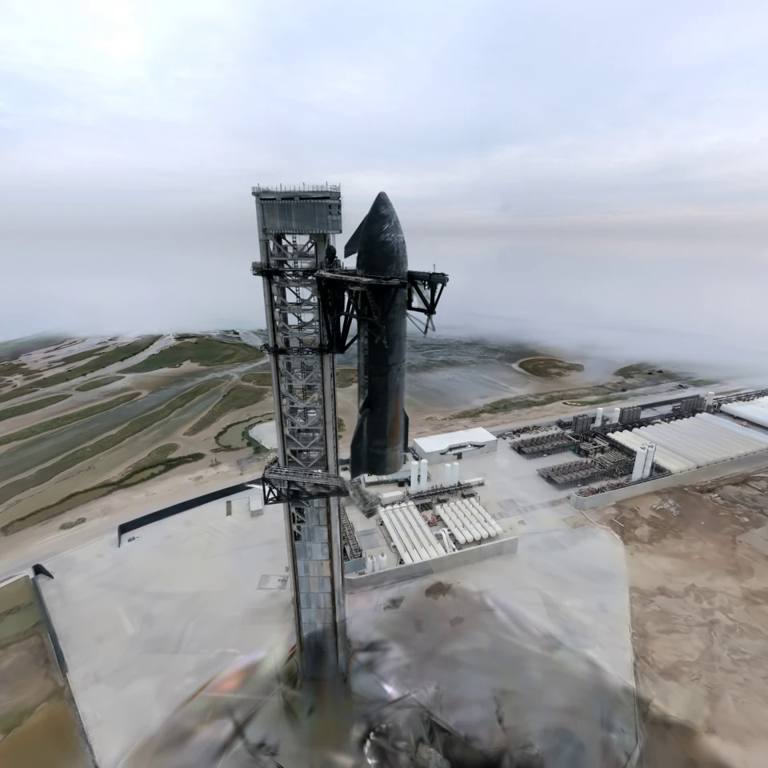

# Ship 42 catch — 3D Gaussian splat

Interactive viewer: [josiahwilson.me/starship](https://josiahwilson.me/starship/)

## Downloads

From the [latest release](https://github.com/Aperturesurvivor/starship-s42-splat/releases/latest):

- [s42-catch.ply](https://github.com/Aperturesurvivor/starship-s42-splat/releases/latest/download/s42-catch.ply) — full 3DGS PLY, 855,984 splats, SH degree 0, about 48 MB
- [s42-catch.spz](https://github.com/Aperturesurvivor/starship-s42-splat/releases/latest/download/s42-catch.spz) — compressed, about 11 MB

## How to view

Open [SuperSplat](https://superspl.at/editor) and drag the file in. This file uses COLMAP's Y-down orientation, so rotate 180° on X to stand it upright.

## How it was made

Frames were taken from SpaceX's Flight 15 webcast drone footage, posed with COLMAP, and trained as 3D Gaussian splatting for about 40k iterations, then cleaned in SuperSplat.

## Credit and notice

Source footage is from SpaceX's Flight 15 webcast. This is a fan-made, non-commercial reconstruction and is not affiliated with SpaceX.

Made by Josiah Wilson ([@JustBuildAThing](https://x.com/JustBuildAThing)).

These files are shared for personal and non-commercial viewing.
